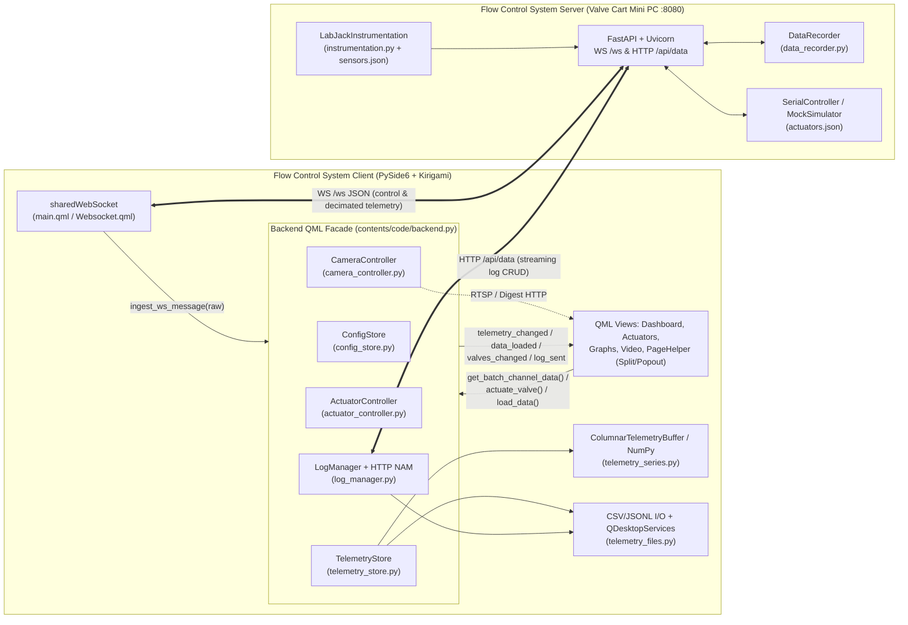

# Flow Control System Client — Documentation

Welcome to the technical documentation for the **Flow Control System Client** (`fcs-client`), a cross-platform desktop ground control station built with **Python (PySide6)** and **KDE Kirigami / QtQuick (QML)**.

---

## Contents

1. **[Signals & QML–Python Bridge (`signals-and-bridge.md`)](./signals-and-bridge.md)**
   - Complete reference of every signal, `@QtCore.Property` binding, and `@QtCore.Slot` method exposed on the `Backend` facade (`contents/code/backend.py`).
   - Architecture of the five composed Python `QObject` controllers (`config_store.py`, `camera_controller.py`, `actuator_controller.py`, `log_manager.py`, `telemetry_store.py`) and standard PySide6 camelCase conventions (post-`__feature__` removal).
   - Pull-based windowed telemetry queries (`get_channel_data`, `get_batch_channel_data`), `ColumnarTelemetryBuffer` (`numpy` `float64` arrays + `50,000`-sample live ring buffer), unit conversions, and internal QML component signals (`PageHelper`, `PopoutWindow`, `SplitPaneFrame`, `Actuators`, `Dashboard`, `Graphs`, `Video`).

2. **[Communication Protocol — WS `/ws` & HTTP `/api/data` (`websocket-protocol.md`)](./websocket-protocol.md)**
   - End-to-end communication architecture across **QML Frontend ↔ Python Client Backend ↔ FastAPI/Uvicorn Valve Cart Server**.
   - Real-time `WS /ws` wire protocol (`init` with `channels` metadata from `sensors.json`, `telemetry` in metric units, `valve_state`/`summary`, `armed`, `alert`, `command`, `abort`, `unabort`, `record`) and connection/reconnection state machine.
   - Streaming HTTP `/api/data/...` log CRUD (`GET`, `PUT`, `POST /rename`, `DELETE`) via `QNetworkAccessManager` in `log_manager.py`, with automatic WebSocket `remote_data_req` fallback for legacy servers.

---

## System Architecture Overview

---

## Related Repositories in Workspace

| Repository | Role | Key Resources |
| :--- | :--- | :--- |
| **`Flow-Control-System-Client`** | Active PySide6 + Kirigami desktop client | `Backend` facade + 5 controllers, `ColumnarTelemetryBuffer` (`numpy`), `GraphCanvas.qml` (`QtQuick.Shapes`), split-view/popout navigation, RTSP camera view, GHCR Arch AppImage & MSYS2 Windows CI builds |
| **`Flow-Control-System-Server`** | Active FastAPI + Uvicorn Valve Cart server | Unified `WS /ws` + `HTTP /api/data` (`ws_server.py`), Pydantic-validated `sensors.json`, `LabJackInstrumentation` (`83.3 Hz` disk / decimated WS), `DataRecorder`, unified Uvicorn+FCS logging (`logging_config.py`), systemd deployment scripts (`tools/`) |
| **`PDP-Monitoring-System`** | Legacy Valve Cart backend & Arduino firmware | `Controls.ino` / `Valve.cpp` firmware, legacy `serialInterface.py` CSV command reference |
| **`PDP-Ground-Support`** | Legacy React/MobX web frontend | Historical P&ID node reference |
| **`Propulsion-Test-Data`** | Historical cold-flow and hot-fire datasets | Reference two-row CSV format and post-processing scripts |
