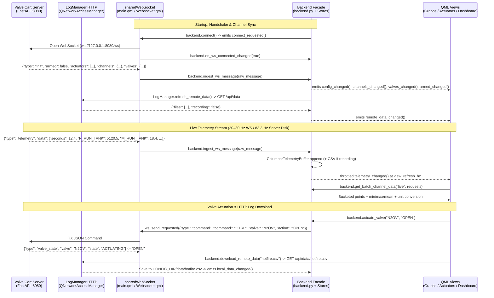

# WebSocket & HTTP Log Transfer Protocol (Client ↔ Backend ↔ Server)

This document specifies the dual-channel network architecture linking the **QML Frontend** ([`main.qml`](../contents/qml/main.qml) / [`Websocket.qml`](../contents/qml/Websocket.qml)), the **Python Client Backend** ([`backend.py`](../contents/code/backend.py) + controllers), and the **FastAPI + Uvicorn Valve Cart Server** (`Flow-Control-System-Server`).

---

## 1. Architectural Reasoning: Hybrid WebSocket + HTTP `/api/data` Split

1. **WebSocket `/ws` in QML + Python Ingestion:** `QtWebSockets.WebSocket` lives in [`contents/qml/main.qml`](../contents/qml/main.qml) (`id: sharedWebSocket`) so QML toolbars bind natively to `status` and `errorString`. Every inbound text frame is handed directly to `backend.ingest_ws_message(message)` for single-pass JSON parsing and $O(\log N)$ columnar ingestion (`ColumnarTelemetryBuffer`).
2. **Real-Time Control/Telemetry vs. Streaming File CRUD:** Passing multi-megabyte CSV telemetry downloads or uploads base64/JSON-escaped over `/ws` blocks live telemetry broadcasts and delays `ABORT` command dispatch. Starting in Phase 2/4:
   - **`WS /ws`** handles low-latency bidirectional JSON frames (`init`, `telemetry`, `valve_state`, `summary`, `armed`, `alert`, `command`, `abort`, `unabort`, `record`).
   - **`HTTP /api/data/...`** handles remote telemetry log listing, streaming download, upload, rename, and delete asynchronously in [`contents/code/log_manager.py`](../contents/code/log_manager.py) via `QtNetwork.QNetworkAccessManager` (derived from `ws_url_to_http_base()`), automatically falling back to WebSocket `remote_data_req` messages when connected to older WebSocket-only servers.

---

## 2. End-to-End Message & Request Flow



---

## 3. Connection Lifecycle & Reconnection State Machine

Managed by [`contents/qml/main.qml`](../contents/qml/main.qml), [`contents/qml/Websocket.qml`](../contents/qml/Websocket.qml), [`contents/code/config_manager.py`](../contents/code/config_manager.py), and [`contents/code/backend.py`](../contents/code/backend.py):

1. **URL Resolution Priority (`config_manager.read_app_config`):**
   - `FLOW_CONTROL_WS_URL` environment variable (highest precedence)
   - `server.default_url` in active `config.json`
   - Fallback default `"ws://127.0.0.1:8080/ws"`
2. **Startup Connection:** `main.py` calls `backend.connect()`, emitting `connect_requested`. Only the topbar compact `Websocket.qml` (`compact: true`) responds and opens `sharedWebSocket` when `backend.auto_reconnect` is `true`.
3. **Connected Hook (`Backend.on_ws_connected_changed(True)`):**
   - Resets server recording prompt state and refreshes remote log list via `GET /api/data` (or WS fallback).
   - If local CSV recording is already active (`self.recording`), sends `{"type": "record", "command": "RECORD", "active": true, "filename": ...}` so the server records in sync.
4. **Disconnected Hook (`Backend.on_ws_connected_changed(False)`):**
   - Immediately disarms (`self.set_armed(False)`).
   - Stops any active client CSV recording (`self.set_recording(False)`) with a `WARN` toast.
   - On `True → False` transitions, emits `disconnected` and `websocket_closed` so `Dashboard.qml` commits pending file deletions.
5. **Auto-Reconnect Timer (`autoReconnectTimer`):** Retries every `backend.reconnect_interval_ms` (default `2000` ms) while `compact === true`, `auto_reconnect === true`, and `root.userDisconnected === false`, deduplicating identical socket errors via `_lastLoggedError`.

---

## 4. WebSocket Wire Protocol Specification (`WS /ws`)

### 4.1 Server → Client Messages

#### A. Initial State, Actuators & Sensor Channels (`type: "init" | "actuators" | "config"`)
Sent immediately when a client connects (or when `reset` reloads `actuators.json`):

```json
{
  "type": "init",
  "system": "Flow-Control-System-Server (Mock)",
  "armed": false,
  "recording": false,
  "recording_filename": null,
  "actuators": [
    {
      "id": "N2OV",
      "label": "N2O Valve (N2OV)",
      "type": "servo",
      "normal_state": "CLOSED",
      "states": ["OPEN", "CLOSED"],
      "hint": "2 LS",
      "key": "1"
    }
  ],
  "channels": {
    "P_INJECTOR": {"pin": "AIN82", "unit": "kPa", "mode": "DIFF", "gain_index": 100},
    "P_COMB_CHMBR": {"pin": "AIN85", "unit": "kPa", "mode": "DIFF", "gain_index": 100},
    "P_N2O_FLOW": {"pin": "AIN84", "unit": "kPa", "mode": "DIFF", "gain_index": 100},
    "P_N2_FLOW": {"pin": "AIN83", "unit": "kPa", "mode": "DIFF", "gain_index": 100},
    "P_RUN_TANK": {"pin": "AIN81", "unit": "kPa", "mode": "DIFF", "gain_index": 100},
    "M_RUN_TANK": {"pin": "AIN86", "unit": "kg", "mode": "DIFF", "gain_index": 1000},
    "L_THRUST": {"pin": "AIN87", "unit": "N", "mode": "DIFF", "gain_index": 1000},
    "T_RUN_TANK": {"pin": "AIN49", "unit": "C", "mode": "SING", "gain_index": 100, "thermocouple": true},
    "T_INJECTOR": {"pin": "AIN57", "unit": "C", "mode": "SING", "gain_index": 100, "thermocouple": true},
    "T_COMB_CHMBR": {"pin": "AIN55", "unit": "C", "mode": "SING", "gain_index": 100, "thermocouple": true},
    "T_POST_COMB": {"pin": "AIN53", "unit": "C", "mode": "SING", "gain_index": 100, "thermocouple": true}
  },
  "valves": {
    "N2OV": "CLOSED",
    "DUMP": "OPEN",
    "RTV": "CLOSED",
    "QD": "CONNECTED",
    "MEV": "READY",
    "MRV": "READY"
  }
}
```
- `TelemetryStore.apply_live_channels_metadata()` ingests `"channels"` so the client's live source units and channel dropdowns match `sensors.json` automatically without hardcoding channel tables.
- If `"recording": true` on connect while the client is not recording, `serverRecordingDialog` opens in `main.qml` to let the user pull the server's in-progress log (`pull_server_recording_state()`).

#### B. Live Telemetry Frame (`type: "telemetry"`)
Handled by [`ingest_ws_telemetry_frames()`](../contents/code/telemetry_series.py) + [`extract_flat_values()`](../contents/code/telemetry_files.py). Accepts grouped `pressures`/`temperatures`/`loads` dicts, flat `data` dicts, or top-level raw JSONL lines:
```json
{
  "type": "telemetry",
  "data": {
    "packet_id": 1042,
    "seconds": 104.2,
    "uptime": 104.2,
    "P_RUN_TANK": 5120.5,
    "P_INJECTOR": 3715.6,
    "M_RUN_TANK": 18.4,
    "L_THRUST": 1680.0,
    "T_RUN_TANK": 19.4,
    "T_COMB_CHMBR": 685.0
  }
}
```
- **Metric Server Defaults:** Pressures in `kPa`, `M_RUN_TANK` mass in `kg`, `L_THRUST` in `N`, temperatures in `°C` (`C`).
- **Open-Thermocouple Faults:** Server converts out-of-range voltages to `math.nan`, sanitized to `null` in WS JSON (and skipped during columnar ingestion so lines never snap to `0 °C`), accompanied by a rate-limited server `WARN` alert.
- **Unrecognized Channels:** Auto-registered with prefix defaults (`P_*` → `kPa`, `T_*` → `°C`, `M_*` / `L_RUN_TANK` → `kg`, `L_*` → `N`).

#### C. Valve State (`type: "valve_state" | "summary"`), Armed (`type: "armed"`), Alert (`type: "alert"`)
- Valve states normalize via `ActuatorController.normalize_valve_state()`: `CLOSE` → `CLOSED`, `TRANSIT` → `ACTUATING`, `FILLING` → `FILL`, `VENTING` → `VENT`. Legacy `FEEDBACK` / `STARTUP` envelopes are also accepted.
- `{"type": "armed", "armed": true|false}` syncs the topbar `SYSTEM ARMED` / `SYSTEM SAFE` badge.
- `{"type": "alert", "level": "INFO"|"WARN"|"ERR", "message": "..."}` routes into `LogToaster` and `NotificationTray`.

---

### 4.2 Client → Server Messages

| `type` | Payload | Interlocks / Behavior |
| :--- | :--- | :--- |
| `command` | `{"type": "command", "command": "CTRL", "valve": "N2OV", "action": "OPEN"}` | Blocked in client (`ActuatorController.actuate_valve`) and re-validated on server if `!armed`, `external == true`, or `single_use == true` and already `FIRED`/`DISCONNECTED`. |
| `abort` | `{"type": "abort", "command": "ABORT"}` | Always permitted regardless of `armed` state. |
| `record` | `{"type": "record", "command": "RECORD", "active": true|false, "filename": "..."}` | Starts/stops synchronized CSV logging (`kPa, ..., kg, N, C, ..., s`). |
| `remote_data_req` | `{"type": "remote_data_req", "operation": "list"|"get"|"put"|"rename"|"delete", ...}` | Used automatically as WebSocket fallback if HTTP `/api/data` fails or when pulling an unnamed active recording (`filename == ""`). |

---

## 5. HTTP `/api/data` Log Transfer Protocol (`LogManager` ↔ FastAPI)

[`LogManager`](../contents/code/log_manager.py) converts `server_url` (`ws://` → `http://`, `wss://` → `https://`) via `ws_url_to_http_base()` and builds `/api/data/...` URLs with URL-encoded basenames via `build_api_data_url()`:

| Client Method | HTTP Request | Server Response / Client Effect | WS Fallback |
| :--- | :--- | :--- | :--- |
| `refresh_remote_data()` | `GET /api/data` | Returns `{"files": [...], "recording": bool, "recording_filename": ...}`; updates `remote_data`. | `remote_data_req` (`operation: "list"`) |
| `fetch_remote_file()` / `download_remote_data()` / `load_data("remote", ...)` / `pull_server_recording_state(fname)` | `GET /api/data/{filename}` | Streams raw CSV/JSONL bytes; saves to `CONFIG_DIR / "data" / <filename>`, then optionally loads viewer (`mode: "load"`) or populates `_live_buffer` (`mode: "pull_recording"`). | `remote_data_req` (`operation: "get"`, `mode`) *(also used when `pull_recording` `filename` is empty)* |
| `push_data_to_remote()` | `PUT /api/data/{filename}` (`Content-Type: text/csv`) | Uploads resolved local/external `.csv`/`.jsonl` bytes to server `data/` and refreshes `remote_data`. | `remote_data_req` (`operation: "put"`) |
| `rename_data("remote", ...)` | `POST /api/data/{old}/rename` with `{"new_name": "..."}` | Renames file inside server `data/` (preserving original extension if omitted) and refreshes `remote_data`. | `remote_data_req` (`operation: "rename"`) |
| `delete_data("remote", ...)` | `DELETE /api/data/{filename}` | Commits deferred deletion on server `data/` and refreshes `remote_data`. | `remote_data_req` (`operation: "delete"`) |
